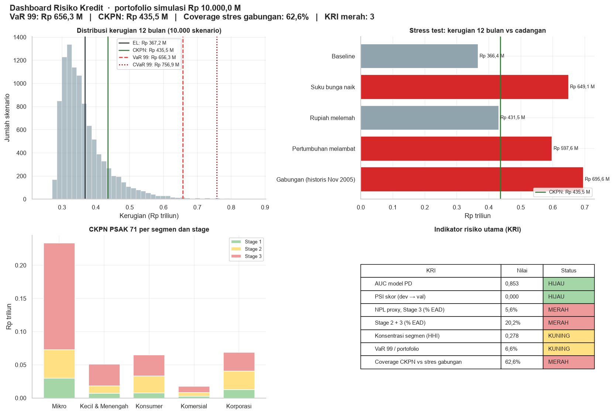
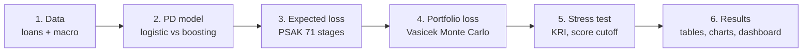
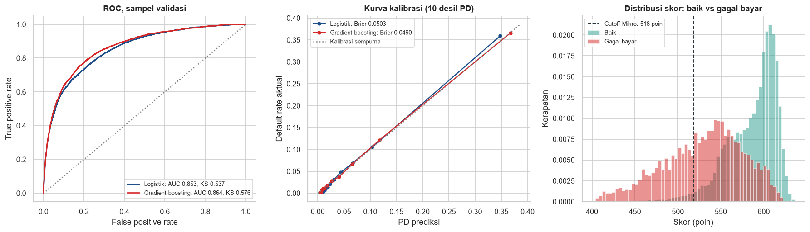

# Credit Risk Model for a Micro and MSME Loan Portfolio

[](https://colab.research.google.com/github/aldo02032004/msme-credit-risk-model/blob/main/msme_credit_risk_model.ipynb)


An end-to-end credit risk model in Python: from a probability of default (PD) score to portfolio losses under macro stress, validated the way a bank validates its models.

The portfolio is **simulated**. Borrowers come from a public loan dataset, and only the segment weights come from BRI's published financial report. It does not describe any real bank.



## Questions answered

1. How well does the PD model rank and calibrate risk, and is it stable?
2. What is the expected loss and the PSAK 71 reserve (CKPN) per segment?
3. How large can a bad year's loss be (VaR 99%, CVaR 99%)?
4. Do reserves cover losses when interest rates rise, the rupiah weakens or growth slows?
5. Which policy reduces the risk the most?

## Pipeline



| Step | What happens | Main output |
|---|---|---|
| 1. Data | 150,000 borrowers from Give Me Some Credit; interest rate, inflation, USD/IDR and GDP from FRED | `gm`, `mk` |
| 2. PD model | Logistic regression (champion) vs gradient boosting (challenger). AUC, Gini, KS, Brier, calibration curve, PSI, backtest per segment | `val`, `coef`, `bt` |
| 3. Expected loss | EL = PD × LGD × EAD per loan, PSAK 71 stages 1-2-3, 12-month and lifetime ECL | `el`, `ecl_stage` |
| 4. Portfolio loss | 10,000 scenarios of a Vasicek one-factor model with Basel IRB correlations; VaR 99, CVaR 99, segment contribution | `m`, `kontrib` |
| 5. Stress and policy | Four macro scenarios vs CKPN, seven KRIs (green / yellow / red), break-even score cutoff | `stres`, `kri`, `cut` |
| 6. Results | Summary, validation charts, tables, dashboard | Tables and figures |

The Monte Carlo set-up, the `P` assumption dictionary, the download-with-CSV-fallback loader and the green / yellow / red status rule are reused from [lng-supply-risk-analysis](https://github.com/aldo02032004/lng-supply-risk-analysis).

## Data

| Data | Source | Notes |
|---|---|---|
| Borrowers | [Give Me Some Credit](https://www.openml.org/d/46929) via OpenML | 150,000 US consumer borrowers, target = serious delinquency within 2 years (6.7%) |
| Interest rate | FRED `IRSTCI01IDM156N` | Indonesian interbank call rate, monthly proxy for the BI rate |
| Inflation | FRED `IDNCPIALLMINMEI` | Consumer price index (BPS), year-on-year change |
| USD/IDR | FRED `CCUSMA02IDM618N` | Monthly average |
| GDP | FRED `NGDPRSAXDCIDQ` | Real GDP (BPS), quarterly, year-on-year growth |
| Segment weights | BRI financial report, Q3 2026 | Loans in IDR trillion: Mikro 707.5, Kecil & Menengah 218.6, Konsumer 242.9, Komersial 80.7, Korporasi 397.5 |

The macro series are downloaded on every run, and a copy in `data/` is used when a download fails.

## Key assumptions

All assumptions are in the first code cell (`P` and `seg`).

| Assumption | Value |
|---|---|
| Portfolio size | IDR 10 T, split by BRI segment weights |
| Segment mapping | Borrowers ranked by income: lowest → Mikro, highest → Korporasi |
| LGD | Mikro 50%, Kecil & Menengah 45%, Konsumer 40%, Komersial 40%, Korporasi 35% |
| EAD | Outstanding × (1 + undrawn share × CCF), CCF 50%-75% |
| 12-month PD | 1 − (1 − PD₂ᵧ)^½ from the 2-year model PD |
| Stage 3 | Ever 90+ days late (proxy for credit-impaired) |
| Stage 2 | 30-89 days late, or 12-month PD ≥ 10% |
| Asset correlation | Basel II IRB curves: retail 3%-16%, corporate 12%-24% |
| Macro weights | Rate 0.3, inflation 0.2, FX 0.2, GDP 0.3 |
| Net margin | 8% a year, for the break-even PD = margin / (margin + LGD) |

## Sample results

Run on macro data up to **Sep 2026**.

| Metric | Value | Meaning |
|---|---|---|
| AUC / KS (logistic) | 0.853 / 0.537 | Gradient boosting is only slightly better (AUC 0.864), so the readable model is kept |
| PSI dev → validation | 0.0003 | Score distribution is stable |
| EL 12 months | IDR 366 B (3.5% of EAD) | Average yearly credit loss |
| CKPN (PSAK 71) | IDR 436 B | Reserve, higher than EL because stage 2 uses lifetime PD |
| VaR 99 / CVaR 99 | IDR 656 B / 757 B | 1-in-100 bad year, and the average of the worst 1% |
| Combined stress (Nov 2005 replay) | IDR 696 B | Rate +4.8 pp, inflation 18%, USD/IDR +11% |
| Coverage under combined stress | 63% by CKPN, 104% by CKPN + UL | Reserves alone fall short, reserves plus economic capital cover it |

Key findings:
- **Mikro drives the risk.** It holds 41% of exposure but 58% of expected loss and 48% of tail loss (CVaR 99).
- **Rising rates and slowing growth hurt most.** Each pushes the 12-month loss above the reserve; a weaker rupiah alone does not.
- **Recommendation: a break-even score cutoff per segment** (518 points for Mikro). It rejects 4.7% of applicants, whose actual bad rate was 49% vs 4.6% for the rest. Expected loss falls 49% and VaR 99 falls 29%.



## How to run

**Google Colab (easiest):** click the *Open in Colab* badge and run all cells.

**Locally:**
```bash
git clone https://github.com/aldo02032004/msme-credit-risk-model.git
cd msme-credit-risk-model
pip install -r requirements.txt
jupyter notebook msme_credit_risk_model.ipynb
```

The first run downloads the loan data from OpenML (about 7 MB) and caches it. No API key is needed.

## Project structure

```
msme-credit-risk-model/
├── msme_credit_risk_model.ipynb   # main notebook, executed with outputs
├── data/                          # macro fallback copies (FRED)
├── images/
│   ├── dashboard.png              # section 6.6
│   └── validation.png             # section 6.2
├── requirements.txt
├── LICENSE
└── README.md
```

## Limitations

- The portfolio is simulated: US consumer borrowers mapped to Indonesian segments by income.
- Stage rules are proxies because the data has no current days past due. ECL is undiscounted.
- LGD and CCF are fixed per segment, with no downturn LGD.
- The Vasicek model has one factor and a large-pool approximation, so single-name concentration is not captured.
- Macro weights are assumptions. A bank would estimate them from its own default history.

This project is for learning and portfolio purposes and is not investment advice.

## License

[MIT](LICENSE) © 2026 Naufaldo Indra Pratama
