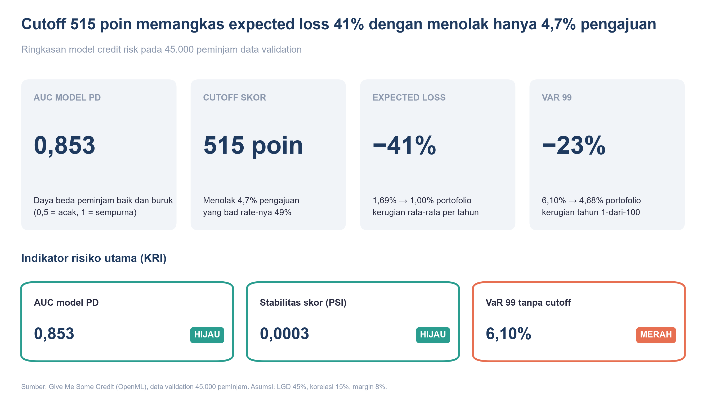
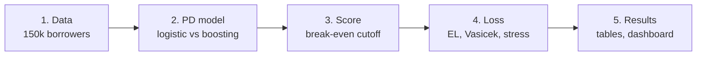
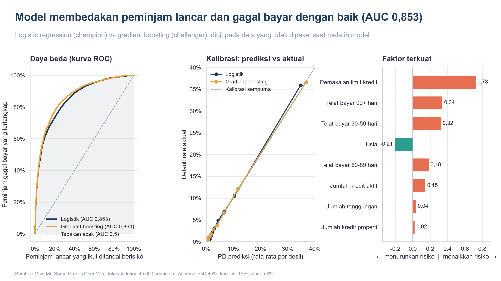
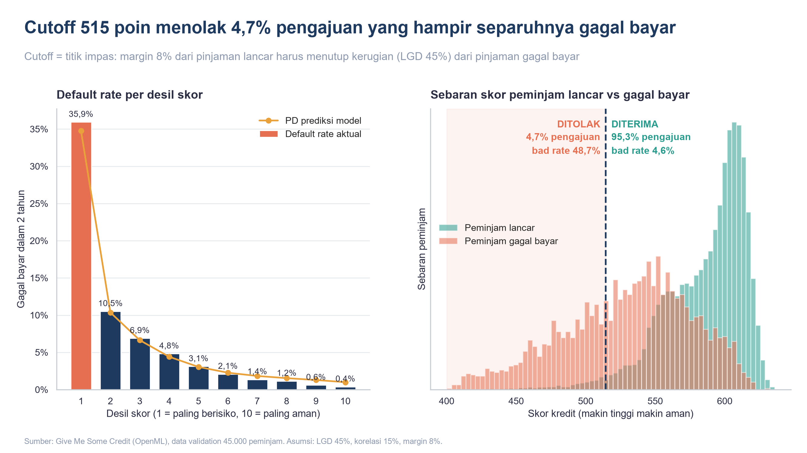
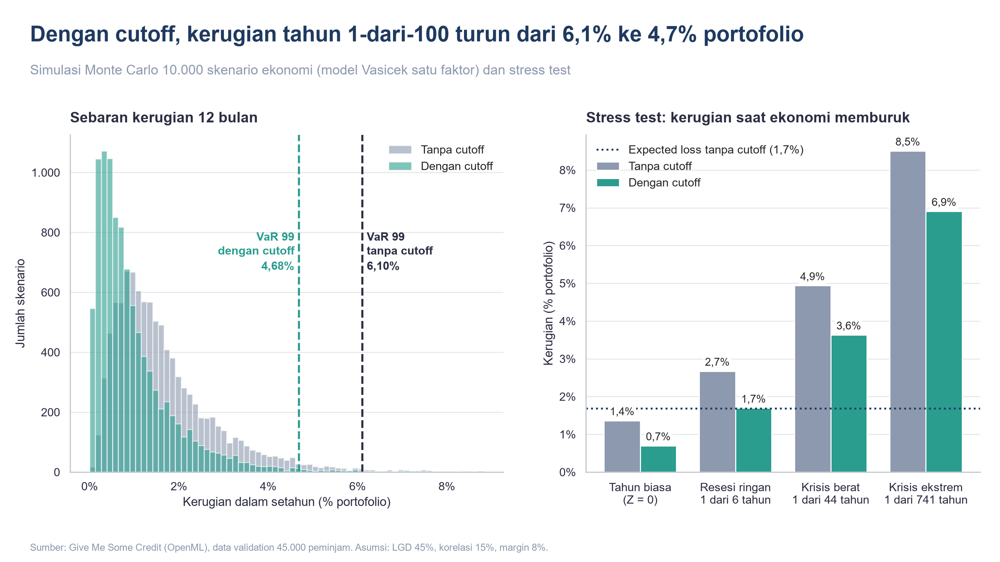

# Consumer Credit Risk Model

[](https://colab.research.google.com/github/aldo02032004/credit-risk-model/blob/main/credit_risk_model.ipynb)


A probability of default (PD) model built on 150,000 real borrowers and validated the way a bank validates its models. The notebook then turns the model into a score cutoff and estimates the portfolio's expected loss, VaR and stressed loss.



## Questions answered

1. How well does the PD model rank and calibrate risk, and is it stable?
2. Which score cutoff makes lending profitable, and what does it change?
3. What is the expected loss, and how large can a bad year's loss be?

## Pipeline



| Step | What happens | Main output |
|---|---|---|
| 1. Data | Give Me Some Credit, 10 features, 2-year default target | `gm`, `y` |
| 2. PD model | Logistic regression (champion) vs gradient boosting (challenger). AUC, Gini, KS, Brier, calibration curve, PSI | `val`, `coef` |
| 3. Score | Points scale (600 = odds 50:1), break-even cutoff, default rate per score decile | `cutoff`, `band` |
| 4. Loss | EL = PD × LGD × EAD, 10,000-scenario Vasicek Monte Carlo, stress at Z = −1, −2, −3 | `m`, `stres`, `kri` |
| 5. Results | Summary, validation charts, tables, dashboard | Tables and figures |

The Monte Carlo set-up and the green / yellow / red status rule are reused from [lng-supply-risk-analysis](https://github.com/aldo02032004/lng-supply-risk-analysis).

## Data and assumptions

**Data:** [Give Me Some Credit](https://www.openml.org/d/46929), downloaded from OpenML by scikit-learn. 150,000 borrowers; the target is 90+ days past due within 2 years (6.7%).

There are only four assumptions, and all of them are in `P`:

| Assumption | Value | Why |
|---|---|---|
| LGD | 45% | Basel foundation IRB value for unsecured senior exposure |
| EAD | Equal for every loan | No loan amounts in the data, so losses are shown as % of the portfolio |
| Asset correlation ρ | 15% | Upper end of the Basel retail range |
| Net margin | 8% a year | Used for the break-even PD = margin / (margin + LGD) ≈ 15% |

## Results

| Metric | Value | Meaning |
|---|---|---|
| AUC / Gini / KS | 0.853 / 0.707 / 0.537 | Strong ranking. Gradient boosting reaches only about 0.86, so the readable model is kept |
| Calibration | Mean PD 6.7% = actual 6.7% | The PD level is right, not just the ranking |
| PSI dev → validation | 0.0003 | Score distribution is stable |
| Cutoff | 515 points | Rejects 4.7% of applicants |
| Bad rate, rejected vs approved | 48.7% vs 4.6% | Measured on actual outcomes |
| EL (12 months) | 1.69% → 1.00% of portfolio | Without → with cutoff |
| VaR 99 | 6.10% → 4.68% of portfolio | 1-in-100 bad year |
| Severe stress (Z = −2, 1 in 44 years) | 4.94% of portfolio | 2.9 × expected loss |

Key findings:
- **Credit utilization and past delinquency drive default.** They have the largest coefficients; older borrowers are safer.
- **The model ranks risk cleanly.** Actual default rate falls from 36% in the lowest score decile to 0.4% in the highest.
- **Recommendation: a break-even cutoff at 515 points.** It turns away a small group whose actual bad rate is about eleven times the rest, cuts expected loss by 41% and VaR 99 by 23%.

### Charts

Each chart is a 16:9 slide saved in `images/`, with the main message as its title (labels are in Indonesian).





## How to run

**Google Colab (easiest):** click the *Open in Colab* badge and run all cells.

**Locally:**
```bash
git clone https://github.com/aldo02032004/credit-risk-model.git
cd credit-risk-model
pip install -r requirements.txt
jupyter notebook credit_risk_model.ipynb
```

The first run downloads the data from OpenML (about 7 MB). No API key is needed.

## Limitations and next steps

- LGD, EAD and correlation are single assumed values. With real loan data they would be estimated from recoveries, limits and drawdowns.
- The Vasicek model has one factor and a large-portfolio approximation, so concentration in large borrowers is not captured.
- Stress scenarios are set directly on the systematic factor Z. A bank would link Z to macro variables by regressing its own default history on them.
- **Next steps:** PSAK 71 / IFRS 9 staging needs days-past-due data. For Indonesian micro and MSME lending, the portfolio could be split by segment weights from a bank's published report, with segment-specific LGD.

This project is for learning and portfolio purposes and is not investment advice.

## License

[MIT](LICENSE) © 2026 Naufaldo Indra Pratama
